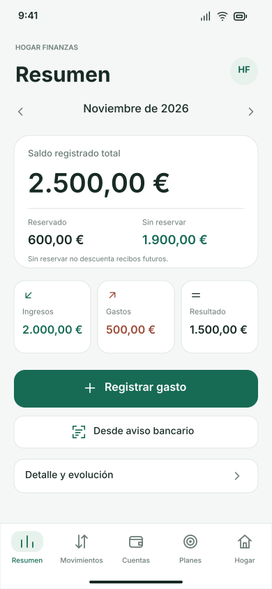

# Dashboard editable de Hogar Finanzas

Cuatro diseños con datos ficticios: iPhone 390 × 844 y Mac 1280 × 800, en claro y oscuro. Priorizan el saldo total, las reservas y el resultado mensual en una sola pantalla. El detalle queda cerrado y la navegación inferior no tiene mensajes superpuestos.

## Textos y capas nativos de Figma (recomendado)

1. Descarga y descomprime **HogarFinanzas-Dashboard-Figma.zip**.
2. Abre la aplicación **Figma Desktop** y crea un archivo de **Figma Design** vacío.
3. En el menú de Figma, busca **Plugins → Development → Import plugin from manifest…** (Importar plugin desde un manifiesto).
4. Selecciona `Figma/manifest.json` de la carpeta descomprimida.
5. En **Plugins → Development**, ejecuta **Hogar Finanzas · Dashboard editable**.
6. Aparecerán las cuatro mesas de trabajo. Selecciona un título o importe y haz doble clic para editar el texto. También puedes cambiar colores, tamaños, posiciones y ocultar capas.

Las capas tienen nombres en español. Los importes, las etiquetas y los textos de botones son nodos de texto nativos, no una imagen. Los iconos son vectores. Se usan Inter o, si no está disponible, Roboto. El importador no solicita red, acceso a tu perfil ni credenciales, y no publica el diseño.

Si quieres un archivo `.fig`, guarda una copia local **desde Figma** después de importar. Este paquete no finge ser un `.fig` exportado: utiliza la API de Figma para crear sus capas.

## Importación rápida como SVG

Arrastra cualquiera de los cuatro archivos `Dashboard-…svg` al lienzo de Figma. Tendrás elementos vectoriales, pero Figma puede convertir o interpretar los textos al importar SVG. Para editar textos como textos de Figma, usa el importador anterior.

- `Dashboard-iPhone-claro.svg`
- `Dashboard-iPhone-oscuro.svg`
- `Dashboard-Mac-claro.svg`
- `Dashboard-Mac-oscuro.svg`

## Qué incluye y qué no

El diseño es una propuesta editable, no una captura de la aplicación. Cambiarlo en Figma **no modifica automáticamente el código SwiftUI**. Los frames usan posiciones absolutas; puedes agrupar, convertir a Auto Layout o crear componentes dentro de Figma.

Las cifras siguen el caso financiero de ejemplo: saldo 2.500 €, ingresos 2.000 €, gastos 500 €, reservas 600 € y saldo sin reservar 1.900 €. No representan datos bancarios reales. Se conserva la aclaración de que el saldo sin reservar no descuenta compromisos futuros.

`dashboard-editable.json` es la especificación estructurada; el importador incluye una copia para funcionar sin archivos ni red. `generate_dashboard.py` regenera SVG, JSON y código del plugin. No es necesario ejecutar Python para editar el resultado en Figma.

Validación realizada: XML de los SVG, renderizado local para inspección visual y prueba del contrato de API del importador (cuatro frames, 110 textos nativos, fuentes y limpieza ante error). No se ha ejecutado el plugin en una cuenta real de Figma; su importación final se comprueba en tu Figma Desktop.

